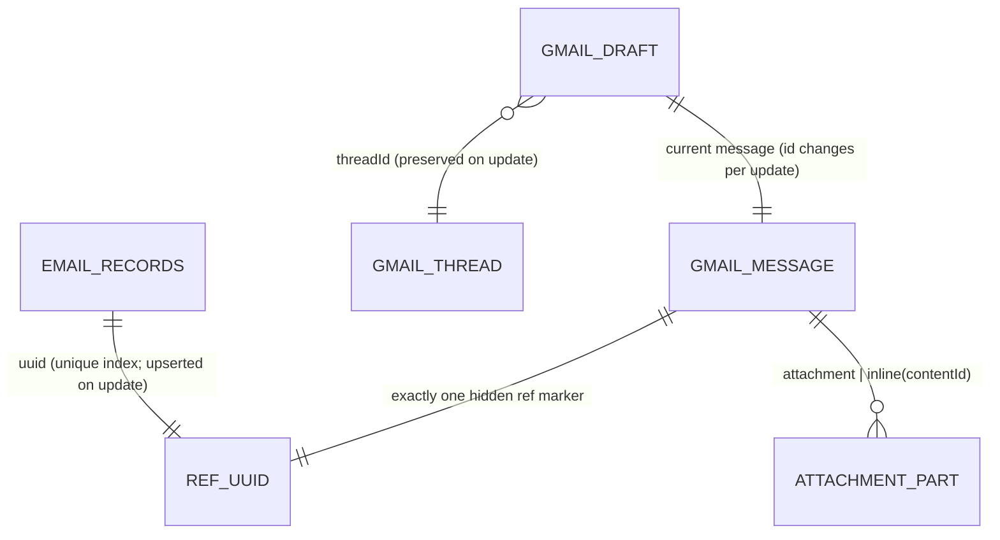

# Gmail draft edit, attachment sources and upload transport — the contract

Owner: advisor task `a089192369f3` (Maestro, project `google-workspace-mcp`,
epic `0795bafff702`). Written 2026-10-23 against `main` @ `8360e74`.

Three implementer tasks depend on this page:

| Task | Slice | Owns |
| --- | --- | --- |
| `86981006082e` | `gmail_get_draft` + `gmail_update_draft` (the CC bug) | `GmailService.getDraft/updateDraft`, two tools |
| `50e6d8b532e9` | `{url}` + `{r2Key}` attachment sources | `outgoing-attachments.ts` |
| `1f52a1fab0e0` | `/upload/gmail/v1` transport + oversized body | new `gmail/transport.ts`, `mime.ts` |

**Merge order:** `86981006082e` → `50e6d8b532e9` → `1f52a1fab0e0`. The transport
task merges last because it re-routes every call site, including the new
`updateDraft`.

**Base branch:** `jmbish04/google-workspace-mcp` `main`. The farm worktrees were
cut from upstream `gemini-cli-extensions/workspace`, which has no Worker. Run
`git fetch fork main && git reset --hard fork/main` in your own worktree. Push to
`fork`, and open PRs with `gh pr create -R jmbish04/google-workspace-mcp`.

---

## 0. Fixed in this PR: re-composing with the same id made the marker visible

`composeBody(previousHtml, { uuid: sameUuid })` used to keep the body's own
hidden `ref:<uuid>` `<div>`. `toEmailBlocks` then retagged it as a plain `<p>`,
and the recipient read `ref:1111…` as body text. Draft Studio revisions hit this
path today.

`composeBody` now drops its own marker and stamps exactly one fresh hidden one.
Re-composing is **idempotent**: `composeBody({html: a.html}, {uuid})` returns
`a.html` byte for byte. This is pinned by
`src/backend/gmail/__tests__/compose-roundtrip.test.ts`. Every rule below relies on
it.

---

## 1. `gmail_get_draft`

`GmailService.getDraft(draftId)` calls `GET users/me/drafts/{id}?format=full`.
The tool returns this shape and nothing else:

```ts
interface GmailDraftView {
  draftId: string;
  messageId: string;          // changes on every update; draftId does not
  threadId: string;
  headers: {
    from: string;             // verbatim, display name included
    to: string[]; cc: string[]; bcc: string[];
    subject: string;
    inReplyTo?: string;       // verbatim Message-ID, angle brackets kept
    references?: string;      // verbatim
  };
  uuid: string | null;        // the ONE ref:<uuid> in the html part; null if none
  refCount: number;           // ref markers found; anything but 1 is a defect worth showing
  html: string;               // the stored text/html part, as Gmail holds it
  text: string;               // the stored text/plain part
  attachments: Array<{
    attachmentId: string;     // for users.messages.attachments.get on messageId
    filename: string;
    mimeType: string;
    size: number;
    disposition: "attachment" | "inline";
    contentId?: string;       // inline only, WITHOUT angle brackets
  }>;
}
```

- Parse `uuid` with the same regex `compose.ts` uses (`/ref:([0-9a-f-]{36})/i`)
  on leaf elements of the html part. Never mint a new id on read.
- A part with `body.data` and no `attachmentId` is a body part, not an attachment.
- `bcc` is only present on drafts. Gmail keeps the header on a draft and drops it
  on send.

## 2. `gmail_update_draft`

Gmail has no partial update. `PUT users/me/drafts/{id}` replaces the whole
message. So an update is **get, merge, rebuild, put**, in that order:

```ts
interface UpdateDraftInput {
  draftId: string;
  body?: { mode: "replace" | "append" | "prepend"; markdown?: string; html?: string; text?: string };
  to?: string[] | string;     // REPLACES the list when present
  cc?: string[] | string;     // REPLACES
  bcc?: string[] | string;    // REPLACES
  addCc?: string[];           // appended, de-duplicated case-insensitively (the CC bug)
  addBcc?: string[];
  subject?: string;
  attachments?: AttachmentSpec[];       // ADDED to the retained ones
  removeAttachments?: string[];         // filename or contentId
  as_user?: string;
}
```

Omitted means **keep**. The rules are not optional:

1. **One id for the life of the draft.** Pass the draft's existing `uuid` (from
   §1) to `buildOutgoingRaw` → `composeBody`. Never `newEmailUuid()` on update. If
   the draft has no marker (it was made outside this worker), mint one then.
2. **Every body goes through `composeBody`.** No string replace on the stored
   html. That corrupts the marker and breaks `cid:` bindings.
3. **Merge on the unwrapped inner html.** Remove the outer
   `<div dir="ltr" …>` first. Then:
   - `replace`: compose the new input on its own.
   - `append` / `prepend`: render the new fragment to html (markdown with
     `marked`, text with `textToHtml`). Concatenate it with the old inner html
     and pass the result as `html`. Concatenating the WRAPPED html nests one
     wrapper inside another, because `composeBody` only unwraps a single
     top-level `dir="ltr"` div.
   - Body omitted: re-compose the stored html unchanged. Idempotence (§0) makes
     that a no-op.
4. **Threading is copied, never recomputed.** `threadId` goes back in
   `message.threadId`. `In-Reply-To` and `References` go back verbatim. `From`
   is kept verbatim, and resolved through `fromHeader()` only when absent.
   `subject` is kept unless the caller supplies one.
5. **Attachments are retained by default.** For each attachment kept, fetch its
   bytes with `messages.attachments.get(messageId, attachmentId)`. Re-feed it as
   `{ blob, filename, mimeType }`. For an inline image, re-feed
   `{ blob, filename, mimeType, as: "inline", contentId }` with the **same**
   `contentId`. The html still says `cid:<contentId>`, so a new id breaks the
   image. Retained items count against the same 25 MiB budget. One can now
   overflow to a Drive link; the report says so.
6. **Respect `isConsumerGoogleAccount`.** `@gmail.com` is OAuth-only and never
   DWD. A missing token is the existing actionable "log in" error.
7. **Tracking: upsert, never insert.** `email_records.uuid` carries the unique
   index `email_records_uuid_unique`. `recordEmail` is a plain insert that
   swallows errors, so calling it again with the draft's uuid fails SILENTLY and
   the log keeps the pre-update recipients. Update the existing row by `uuid`
   instead (`onConflictDoUpdate` on `uuid`, setting `recipients`, `subject`,
   `body` and `messageId`). Add that as a `tracking.ts` helper.
8. **Return** `{ draftId, messageId, threadId, uuid, attachments: AttachmentReportItem[], body: ComposeReport }`.
   The harness and the reviewer read these fields.

Live acceptance, which the harness (§5) automates: create a draft, `addCc`, update,
re-get. The cc is present. `threadId` and `References` are unchanged. Prior
attachments are still attached, with inline `cid:` images still resolving. `refCount === 1`.

## 3. Attachment sources: `{url}` and `{r2Key}`

```ts
type AttachmentSpec =
  | { driveFileId: string; as?: Disposition; contentId?: string }
  | { blob: string; filename: string; mimeType?: string; as?: Disposition; contentId?: string }
  | { url: string; filename?: string; mimeType?: string; as?: Disposition; contentId?: string }
  | { r2Key: string; filename?: string; mimeType?: string; as?: Disposition; contentId?: string };
type Disposition = "attach" | "link" | "inline";
```

- **Exactly one source key per item.** The zod schema rejects an item carrying
  two or more of `driveFileId`/`blob`/`url`/`r2Key`. Discriminate with `in`, in
  that order.
- **`url`:** `https:` only. Refuse IP literals and names that resolve into
  loopback, RFC 1918, CGNAT `100.64/10`, link-local `169.254/16` (metadata),
  `0.0.0.0/8`, `::1`, `fc00::/7` and `fe80::/10`. Also refuse `localhost` and
  `*.internal`. Fetch with `redirect: "manual"` and re-check every hop, with at
  most 3 hops. Enforce the remaining byte budget while streaming. Do not trust
  `Content-Length`. Refusal is a thrown error naming the rule, never a silent
  skip. This guard is security; do not simplify it.
- **`r2Key`:** read from `env.R2_FILES_BUCKET`, which is already bound. Missing
  key → a thrown error naming the key.
- `filename` defaults to the last path segment. `mimeType` defaults to the
  response or R2 `httpMetadata.contentType`, then `application/octet-stream`.
- **Over budget or `as:"link"`:** a `url` item links the ORIGINAL https url,
  with no Drive copy. An `r2Key` item is uploaded to Drive and shared
  anyone-with-link, exactly like `blob`.
- `AttachmentReportItem.source` widens to `"drive" | "blob" | "url" | "r2"`.
  `ref` carries the url or the key.

## 4. Upload transport and oversized body

- `mime.ts` gains `buildMimeMessage(o): string`, the unencoded RFC 822 text.
  `buildRawMessage` becomes `toBase64Url(buildMimeMessage(o))`, so existing
  callers do not change.
- `BuiltOutgoing` gains `mime: string` and `encodedBytes: number`.
- New `gmail/transport.ts#submitMessage(env, sub, built, target)` takes a
  `target` of `{ kind: "send", threadId? }`, `{ kind: "draft.create", threadId? }`
  or `{ kind: "draft.update", draftId, threadId? }`. It owns the one decision:
  - At or below 5 MiB encoded, use the JSON `raw` endpoints as today.
  - Above that, use `POST|PUT /upload/gmail/v1/users/me/{messages/send|drafts[/id]}?uploadType=multipart`.
    The body is `multipart/related`: a JSON metadata part (`{threadId}`, plus
    `{id}` for a draft update), then a `message/rfc822` part.
- **Pre-flight before any network call.** If the message exceeds
  `GMAIL_MESSAGE_LIMIT`, throw `GmailSizeError` with the measured and allowed
  sizes. If the composed BODY alone exceeds the limit less 64 KiB of slack,
  throw `GmailBodyTooLargeError`. A body cannot fall back to a Drive link. A raw
  Google 400 reaching the caller is a defect.
- All four call sites route through `submitMessage`: `send`, `createDraft`,
  `createReplyDraft` and `updateDraft`. That is why this task merges last.

## 5. How this is verified on the DEPLOYED worker

`POST /api/gmail-harness/run` (this PR) creates a real draft through the same
`GmailService.createDraft` the tools use, reads it back from Gmail, and checks
the stored html against the standard. Then it round-trips the draft through
get/update and deletes it. Every check carries a severity, and any failed
critical or major check makes `verdict: "fail"` and HTTP 503. The round-trip
checks report `skipped` with a declared reason until `86981006082e` ships
`getDraft`/`updateDraft`. While anything is skipped, the verdict is
`"incomplete"`, never `"pass"`.

## Data

No table changes. One relationship gains a stated cardinality:



`email_records.uuid` is unique (`email_records_uuid_unique`). One row follows the
draft through every update, and the row is upserted rather than duplicated. A send
of that draft reuses the same id, which is what makes it searchable in Gmail
later.
