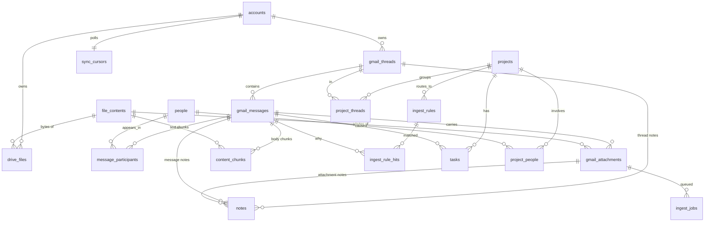

# Gmail / Drive knowledge store on Postgres (plan)

Status: proposed 2026-11-20. Supersedes the D1 thread cache started on branch `claude/mcp-message-caching-19f0c3` (see "What happens to the D1 work").

## Goal

An agent that opens a thread already knows it: every message, every attachment's text, who said what, and what earlier sessions concluded. It never asks the user to download a file and upload it to chat. Important mail and Drive files are indexed and embedded; the rest is left alone.

## Decisions already made (from the owner)

1. Postgres on LXC 109 is the store. The Worker reaches it through Hyperdrive (`env.HYPERDRIVE`, `src/backend/db/postgres.ts`, already live for `documents`).
2. Heavy work leaves the Worker: Gmail polling, attachment download, text extraction, OCR, embeddings run in a Python service on an LXC.
3. The Worker stays as a thin MCP + API proxy.
4. Every integer PK is Postgres identity. Gmail ids are stored too, because the Gmail API needs them.
5. Routing rules decide what is indexed, like Gmail filters. Not everything is indexed.

## Services

| Service | Where | Job |
|---|---|---|
| Postgres 16 + `vector`, `pg_trgm`, `citext` | LXC 109 | system of record |
| `gws-ingest` (Python, FastAPI + worker loop) | new LXC | poll Gmail, run rules, stage attachments via Drive, `rclone` pull, hash, extract, OCR, chunk, embed, write rows |
| `google-workspace-mcp` Worker | Cloudflare | MCP/API proxy, reads Postgres via Hyperdrive, calls `gws-ingest` for work |
| Worker → `gws-ingest` | Workers VPC service (HTTP) over a Cloudflare Tunnel | decided D2 |
| `gws-ingest` → Worker | HTTPS to the Worker URL, `Authorization: Bearer WORKER_API_KEY` | decided D2 |
| Embeddings and any other model call | Core Guardian (`/v1/embeddings`), so usage is metered | decided D3 |

## Schema

Naming: Postgres schema `gws` for the Gmail/Drive store, schema `app` for projects, tasks and AI chat (their names would collide with `gws.gmail_messages` otherwise). Drizzle definitions go in `src/backend/db/schemas/gws/*.ts`, validators derived with drizzle-zod, migrations in `drizzle-postgres/`. Timestamps are `timestamptz`. Every table has `created_at`.

| Table | Key columns | Notes |
|---|---|---|
| `accounts` | `id` identity PK, `email` citext unique, `kind` (workspace/consumer), `token_ref` | replaces D1 `google_accounts` |
| `gmail_threads` | `id` identity PK, `account_id` FK, `gmail_thread_id` text, `subject`, `snippet`, `history_id`, `label_ids` text[], `metadata` jsonb (the full Gmail thread resource minus bodies), `gmail_message_count`, `message_count`, `synced_at`, `last_message_at`, `drive_folder_id` | unique (`account_id`, `gmail_thread_id`). One row per thread. |
| `gmail_messages` | `id` identity PK, `thread_id` FK → `gmail_threads.id`, `gmail_thread_id` text, `gmail_message_id` text, `account_id` FK, `rfc822_message_id`, `in_reply_to`, `subject`, `snippet`, `internal_date`, `label_ids` text[], `headers` jsonb, `body_text`, `body_html`, `urls` jsonb, `size_bytes`, `gone_at` | unique (`account_id`, `gmail_message_id`). Holds both Gmail ids and the FK. Index (`thread_id`, `internal_date`). |
| `people` | `id` identity PK, `email` citext unique, `display_name`, `first_name`, `last_name`, `organization`, `role_note`, `first_seen_at` | one row per human, ever. Optional `profile` jsonb for agent-written facts. |
| `message_participants` | `id` identity PK, `message_id` FK, `person_id` FK, `role` enum (`from`,`to`,`cc`,`bcc`,`reply_to`) | unique (`message_id`, `person_id`, `role`). Answers "who sent / received what". |
| `file_contents` | `id` identity PK, `sha256` unique, `size_bytes`, `mime_type`, `extracted_text`, `extraction_method` enum (`pdf_text`,`ocr`,`docling`,`office_md`,`plain`), `page_count`, `processed_at` | one row per distinct byte string. The dedupe anchor. |
| `gmail_attachments` | `id` identity PK, `message_id` FK, `gmail_part_id`, `gmail_attachment_id`, `filename`, `mime_type`, `size_bytes`, `sha256`, `md5`, `is_junk`, `junk_reason`, `content_id` FK → `file_contents.id` null, `drive_file_id`, `drive_url`, `status` enum (`pending`,`staged`,`extracted`,`embedded`,`skipped_junk`,`error`), `error` | unique (`message_id`, `gmail_part_id`). Every attachment gets a row. A duplicate points at the existing `file_contents` row, so it is recorded but never reprocessed. Junk (signature images, social icons) is recorded with `is_junk` and skipped. |
| `drive_files` | `id` identity PK, `account_id` FK, `drive_file_id` unique per account, `name`, `mime_type`, `parent_drive_id`, `md5`, `modified_at`, `content_id` FK → `file_contents.id` null, `indexed` | Drive files that matched a rule. |
| `content_chunks` | `id` identity PK, `message_id` FK null, `content_id` FK null, `chunk_index`, `text`, `embedding` vector(N), `tsv` tsvector, `model` | CHECK exactly one of `message_id` / `content_id`. HNSW index on `embedding`, GIN on `tsv`. N follows the chosen embedding model (D3). |
| `notes` | `id` identity PK, `thread_id` FK, `message_id` FK null, `attachment_id` FK null, `body`, `author`, `updated_at` | CHECK `attachment_id IS NULL OR message_id IS NOT NULL`. Many notes per target. Cascades follow parents. |
| `app.projects` | `id` identity PK, `key`, `name`, `background` text, `context` jsonb, `status` | migrated from D1 `projects`, extended. "Mr. Roofing" is a project: background and context live here. |
| `app.tasks` | `id` identity PK, `project_id` FK, `title`, `status`, `source_message_id` FK → `gmail_messages.id` null, … | migrated from D1 `tasks`. What we have to do, optionally tied to the message that caused it. |
| `app.project_threads` | `project_id` FK, `thread_id` FK → `gmail_threads.id` | M:N. Which threads belong to which project. |
| `app.project_people` | `project_id` FK, `person_id` FK → `people.id`, `role_note` | M:N. Who is involved in the project (the contractor, the inspector). |
| `app.chat_*` | migrated from D1 `chat_threads`, `threads`, `messages` | AI chat relations kept. |
| `ingest_rules` | `id` identity PK, `name`, `project_id` FK → `app.projects.id` null, `target` enum (`gmail`,`drive`), `priority`, `enabled`, `conditions` jsonb, `actions` jsonb, `version` | the "advanced filters". Conditions: from, to, subject/body contains, label, Gmail query, Drive folder. Actions: index, embed, extract attachments, label, tag with `project_key`. |
| `ingest_rule_hits` | `id` identity PK, `rule_id` FK, `message_id` FK null, `drive_file_id` FK null, `matched_at` | audit: why was this indexed. |
| `sync_cursors` | `account_id` FK PK, `history_id`, `last_polled_at`, `status`, `error` | Gmail history polling position. |
| `ingest_jobs` | `id` identity PK, `kind`, `message_id` FK null, `attachment_id` FK null, `status`, `attempts`, `run_after`, `locked_by`, `error` | Postgres queue (`FOR UPDATE SKIP LOCKED`). No Cloudflare Queue needed. |

D1 tables that move as-is (types translated): `gmail_labels`, `global_config`, `email_records`, `email_drafts` (+ revisions, comments), `scheduled_emails`, `scheduled_sends`, `email_templates`, `email_previews`, `drive_tags`, `drive_notifications`, `workspace_subscriptions`, `appsscript_deployments`, `doc_export_jobs`, `sheet_export_jobs`, `pdf_templates`, `pdf_generation_logs`, `mcp_logs`, `workspace_assets`, `health_*`, `hitl_proposals`, `job_failures`, `render_artifacts`, `braille_artifacts`, `google_documents/sheets/slides`, `drive_folders`, `agent_tasks`, `scheduled_tasks`, `task_events`. Decided D4: `projects`, `tasks`, `team_notes`, `chat_threads`, `threads`, `messages`, `notifications`, `preferences`, `webhooks`, `activity_log` also move, into schema `app`.

## Relationships

| From | To | Cardinality | Enforced by | On delete |
|---|---|---|---|---|
| `gmail_messages.thread_id` | `gmail_threads.id` | M:1 | FK | cascade |
| `message_participants.message_id` | `gmail_messages.id` | M:1 | FK | cascade |
| `message_participants.person_id` | `people.id` | M:1 | FK | restrict |
| `gmail_attachments.message_id` | `gmail_messages.id` | M:1 | FK | cascade |
| `gmail_attachments.content_id` | `file_contents.id` | M:1 | FK | set null |
| `drive_files.content_id` | `file_contents.id` | M:1 | FK | set null |
| `content_chunks.message_id` / `content_id` | `gmail_messages.id` / `file_contents.id` | M:1 | FK + CHECK one-of | cascade |
| `notes.thread_id` / `message_id` / `attachment_id` | threads / messages / attachments | M:1 each | FK + CHECK | cascade |
| `ingest_rule_hits.rule_id` | `ingest_rules.id` | M:1 | FK | cascade |
| `*.account_id` | `accounts.id` | M:1 | FK | restrict |
| `app.tasks.project_id` | `app.projects.id` | M:1 | FK | cascade |
| `app.tasks.source_message_id` | `gmail_messages.id` | M:1 | FK | set null |
| `app.project_threads` | `app.projects` / `gmail_threads` | M:N | composite PK + FKs | cascade |
| `app.project_people` | `app.projects` / `people` | M:N | composite PK + FKs | cascade |
| `ingest_rules.project_id` | `app.projects.id` | M:1 | FK | set null |

Maestro identifiers: `app.projects.key` holds the Maestro `project_key`. Notes and rule hits do not store Maestro issue ids; an agent that wants that writes it into the note text.

Existing tables considered and not reused: D1 `gmail_threads` / `gmail_messages` / `gmail_message_attachments` (text PKs, no FKs, no people table, no content dedupe); D1 `emails_indexed` (empty of relations); the Postgres `documents` / `suggestions` / `document_comments` tables (Tiptap collab, unrelated).

## Attachment pipeline

1. `gws-ingest` sees a matched message. For each part: skip junk (reuse `junkReason` logic ported to Python), else upload to the thread's Drive folder through the Drive API (Gmail → Drive stays an API call; Workers cannot hold the bytes).
2. `rclone` on the LXC pulls the folder. Hash (sha256, md5). If `file_contents.sha256` exists, point the attachment row at it and stop.
3. Extract: `pdftotext` / PyMuPDF; if the PDF has no text layer, `ocrmypdf`; images through Tesseract; Office files through the existing Markdown export or `docling`.
4. Chunk, embed, write `file_contents`, `content_chunks`, flip `status`.
5. Worker tools return `extracted_text` straight from Postgres. No download-and-reupload by the user.

## Migration of existing data

1. Back up D1 first: `wrangler d1 export` into `colby-data` (`colby-data put . backups …`), verify checksum.
2. Measure row counts per table (remote read-only) and record them in the Maestro issue.
3. Loader script maps D1 text ids to new identity ids (Gmail ids stay in their own columns), upserts, resolves FKs by lookup, builds `people` and `message_participants` from `gmail_message_contacts`, and is idempotent.
4. Verify: row counts match, sampled rows hash-match, every FK resolves. Planted-failure test: delete one row, loader verification must go red.
5. Cutover: freeze writes, final delta load, switch Worker reads to Postgres, keep D1 read-only for 14 days, then drop.

## Phases

| # | Work | Depends on |
|---|---|---|
| 1 | Postgres Drizzle schema + migrations + extensions | none |
| 2 | D1 → Postgres loader, backup, verification | 1 |
| 3 | Worker read/write path on Postgres (thread/message cache, notes, people) | 1 |
| 4 | `gws-ingest` service: Gmail poller + rules engine | 1 |
| 5 | Attachment pipeline (Drive staging, rclone, hash/dedupe, extract, OCR) | 4 |
| 6 | Embeddings + search tools | 5 |
| 7 | Routing rules: API, MCP tools, frontend page | 1, 4 |
| 8 | Worker becomes thin proxy; tunnel/VPC; token broker | 3, 4 |

## Decisions (owner, 2026-11-20)

| # | Decision |
|---|---|
| D1 | OAuth on both services. The LXC service and the Worker each hold their own OAuth grant for both accounts (`jmbish04@gmail.com`, `justin@126colby.com`). Local grants live in the `tokens` CLI / service secret store. Request only Gmail and Drive scopes: a grant that holds `cloud-platform` dies with `invalid_rapt` on Workspace accounts. |
| D2 | Worker → service over a Workers VPC HTTP service on a Cloudflare Tunnel (private, no public hostname). Service → Worker over HTTPS with `WORKER_API_KEY`. VPC is one-way (Worker initiates), so the service calls back through the Worker's public API. Workers VPC is in beta and free; the Worker fails closed with a `/health` check when the service is unreachable. Cloudflare Mesh is the fallback if two-way private traffic is ever needed. Hyperdrive may later move onto a VPC service too (Cloudflare's recommended private-database path). |
| D3 | All model calls, embeddings included, go through Core Guardian (`POST /v1/embeddings`, OpenAI-compatible, metered). Default model: OpenAI `text-embedding-3-large` cut to 1,024 dimensions (about $0.13 per 1M tokens), HNSW-indexable. Each chunk stores `model` and `dims`, so a model switch is a re-embed, not a schema change. Phase 6 benchmarks 3 models (this one, `gemini-embedding-001`, `@cf/baai/bge-m3`) on real thread passages before locking. Measured 2026-11-20: `/v1/embeddings` answered 401 to `WORKER_API_KEY`, so the right Guardian token for that route must be confirmed in phase 6. |
| D4 | Keep and migrate `projects`, `tasks`, `team_notes` and the AI chat tables. A project like "Mr. Roofing" holds background and context; tasks hold what must be done. |
| D5 | pgvector is already installed (owner). Phase 1 still checks `CREATE EXTENSION vector` on the target database. |

## What happens to the D1 work

The branch holds an uncommitted D1 thread cache (migration `0030`, `thread-index.ts`, note tools). It is unverified (no typecheck or tests run). Do not deploy it. Keep and port: `gmail/thread-plan.ts` (pure reconcile planner and attachment-row planner), the note-tool surface (`gmail_note_*`, `gmail_notes_list`, `gmail_thread_sync`), and the view shape. Drop: the D1 schema changes and `drizzle/0030_*`.
